# garmin-padel

padel scorekeeper garmin watch app, available in [garmin connect app store](https://apps.garmin.com/apps/c63edba4-4217-4345-9ebc-86a90307e968?tid=0)

## Functionalities

Keeps full padel match score: sets, games, standard **tie-breaks**, and **super tie-break** when configured.

**Setup**

* **Quick presets**: Tournament (best of 3, golden point, no super tie), Tournament with super tie, **Pro set** tournament (single pro set), **Friendly** (unlimited sets), **Training** (free play plus scored drills), or **Custom** to tune everything.
* **Custom match**: number of sets (**1**, **3**, **5**, or **unlimited**), **set type** (normal, pro set, or mini set), optional **super tie-break** (when using 3 or 5 sets), and **point rule**:
  * **Golden point** — deuce is decided by the next point
  * **Advantages** — classic advantage / deuce
  * **Silver point** — one advantage cycle; if it returns to deuce again, the next point wins the game
  * **Star point** (FIP-style) — up to two advantage cycles, then a decisive point at deuce
* **Warm-up**: start with a **warm-up** that is recorded as its own lap (on by default), or turn it off to start scoring straight away.
* **First serve**: choose which team serves first (**Us** / **Them**), or **Skip** to play without the serving indicator.

**During play**

* **Warm-up phase**: the activity starts recording during the warm-up, with a warm-up timer on screen. The first **Up** / **Down** press (or tap) starts the match **without scoring a point**.
* Score with **Up** / **Down** (or top / bottom half of the screen on touch devices).
* **Serving indicator**: a marker along the screen edge on the serving team's half (top = us, bottom = them). It follows padel serving rules, including tie-breaks and super tie-breaks, and undo.
* Real time **heart rate** on the score screen.
* **Options** menu (**Enter** / **Start**, or **long press** on touch): **undo** last point, track an **unforced error**, **switch server** (fix the serving team), or **finish** the activity.
* **Switch to** a **tie-break**, **super tie-break** or **mini set** at any moment (Friendly and Custom matches): for example a final super tie when your court time is running out, without stopping the activity.
* **Training**: practise without a score (**free play**, with a timer), and start a scored **drill** (tie-break, super tie-break, mini set or set) from Options whenever you want. A won drill goes back to free play by itself. See [Training](#training).

**Activity / Garmin Connect**

* Records a **padel** activity; on save, writes **match score** (full history string; not in Training, where each lap has its own result), **steps** during the session, **unforced errors** count, **warm-up length** (when there was a warm-up) and **app version** into the activity for Connect / FIT.
* **Laps**: with a warm-up, **lap 1 is the warm-up** and each set after it is its own lap (lap 2 = set 1, lap 3 = set 2, ...). Without a warm-up, lap 1 is set 1. Switching format in the middle of a set (**Switch to**) also starts a new lap. In **Training**, every free-play period and every drill is its own lap, with the drill's result saved on that lap.

## How to use

### Start and match setup

When you open the app, the initial screen appears. Press `Enter` / `Start`, or tap the screen on a touch device, to continue.

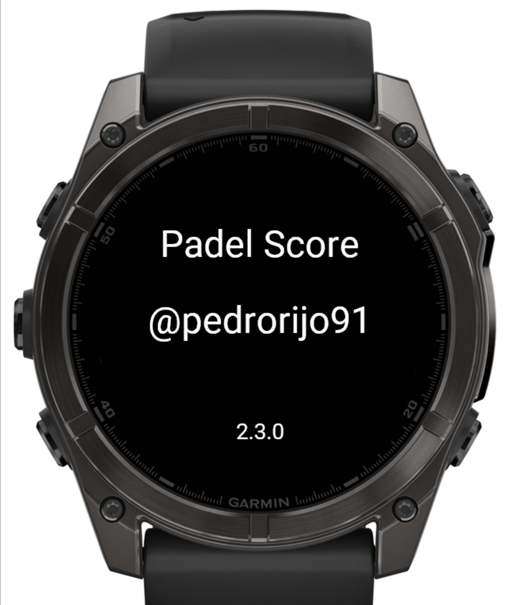

You’ll see the **Game Mode** menu first:

* **Tournament**, **Tournament (super)**, **Pro Set Tournament**, **Friendly** or **Training** — pick one, review the summary, then choose **Start match**. The summary has a **Warm-up: Yes / No** line; select it to switch the warm-up on or off. **Training** has no warm-up line (it starts in free play) and no **First serve** step: choose **Start training** and recording starts.
* **Custom** — walk through **Sets** (1 / 3 / 5 / Unlimited) → **Set type** (Normal / Pro set / Mini) → **Super tie** (only for 3 or 5 sets) → **Score** rule (Golden / Star / Advantages / Silver) → **Warm-up** (Yes / No).
* Both end with **First serve**: pick **Us** or **Them** for the team serving the first game, or **Skip** if you don't want the serving indicator. The match starts right after.

Use `Up` / `Down` to move in menus and `Enter` to select. For exact scoring mechanics (set lengths, tie-breaks, deuce rules), see [Match rules reference](#match-rules-reference).

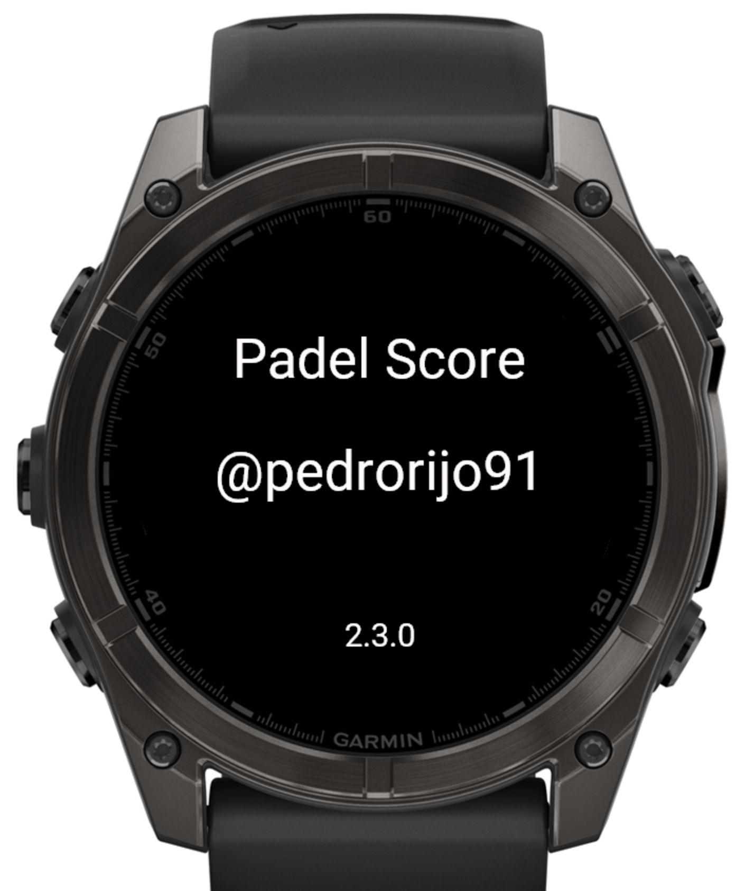

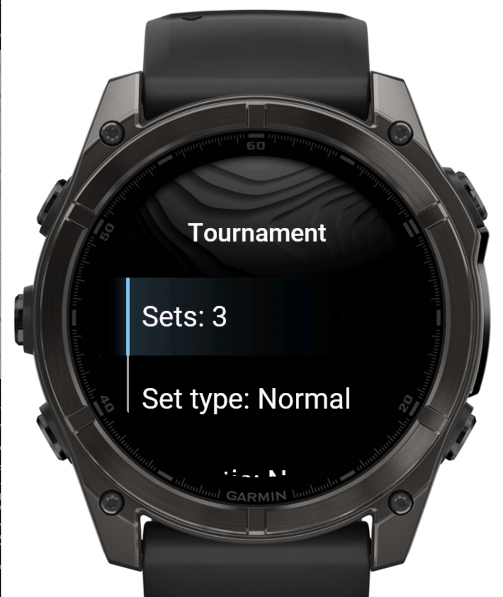

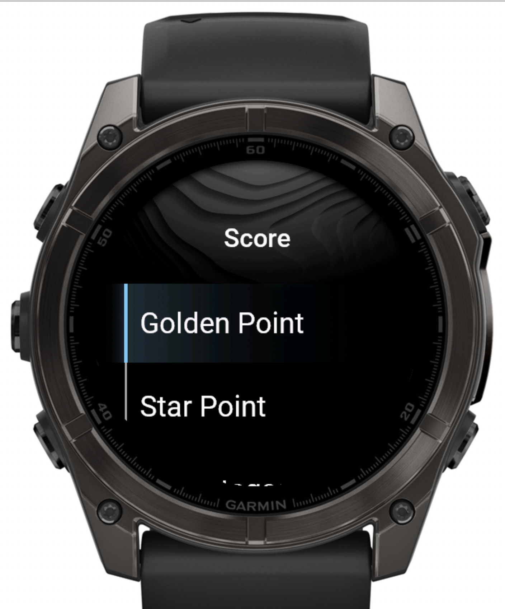

### Warm-up

With **Warm-up: Yes**, the activity starts recording when you finish the setup, but the score screen first shows **Warm-up**, **Press to start** and a timer with the warm-up's length. Nothing is scored yet and the serving indicator is hidden.

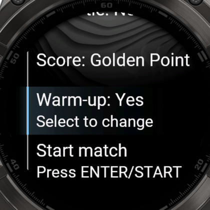
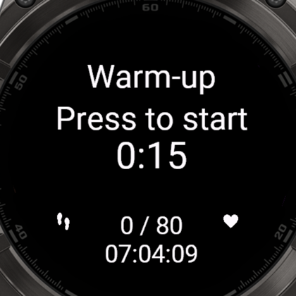

When you're ready to play, press **`Up`** or **`Down`** (or tap the screen) once. This starts the match **without scoring a point**: the watch vibrates briefly and shows **Match started**. You can also use **Options** → **Start match**. The next press scores as usual.

The warm-up is saved as **lap 1** of the activity, so in Garmin Connect lap 1 is the warm-up and lap 2 is the first set. Undo can't go back into the warm-up. During the warm-up, **Options** has **Start match**, **Switch server** and **Finish activity**.

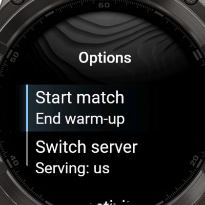
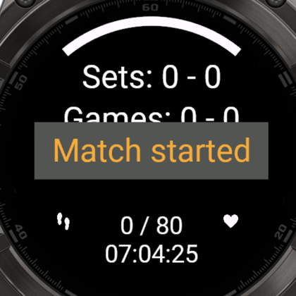

### During the match

The score view shows sets, games, and points (or **Tie** / **Super** when applicable), plus a clock and heart rate. Your team is scored with **`Up`**; the opponent with **`Down`**. On touch devices, tap the **top** half for your point and the **bottom** half for theirs.

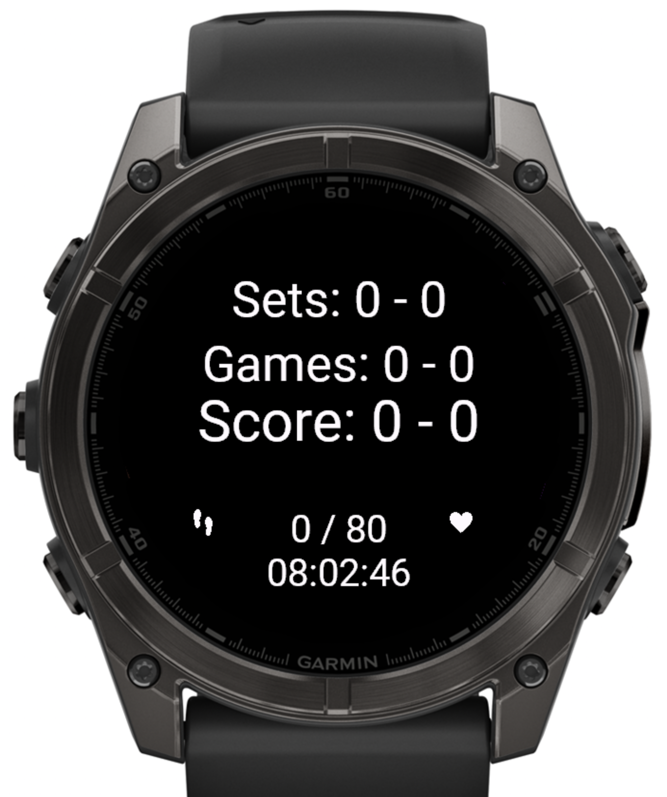

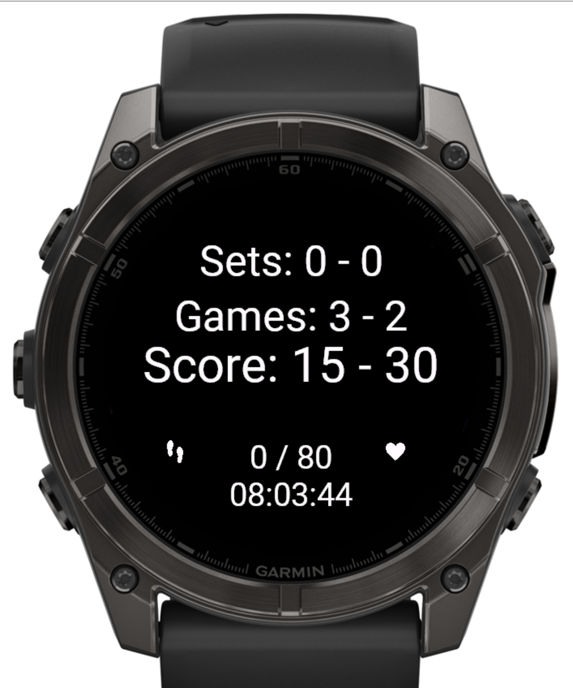

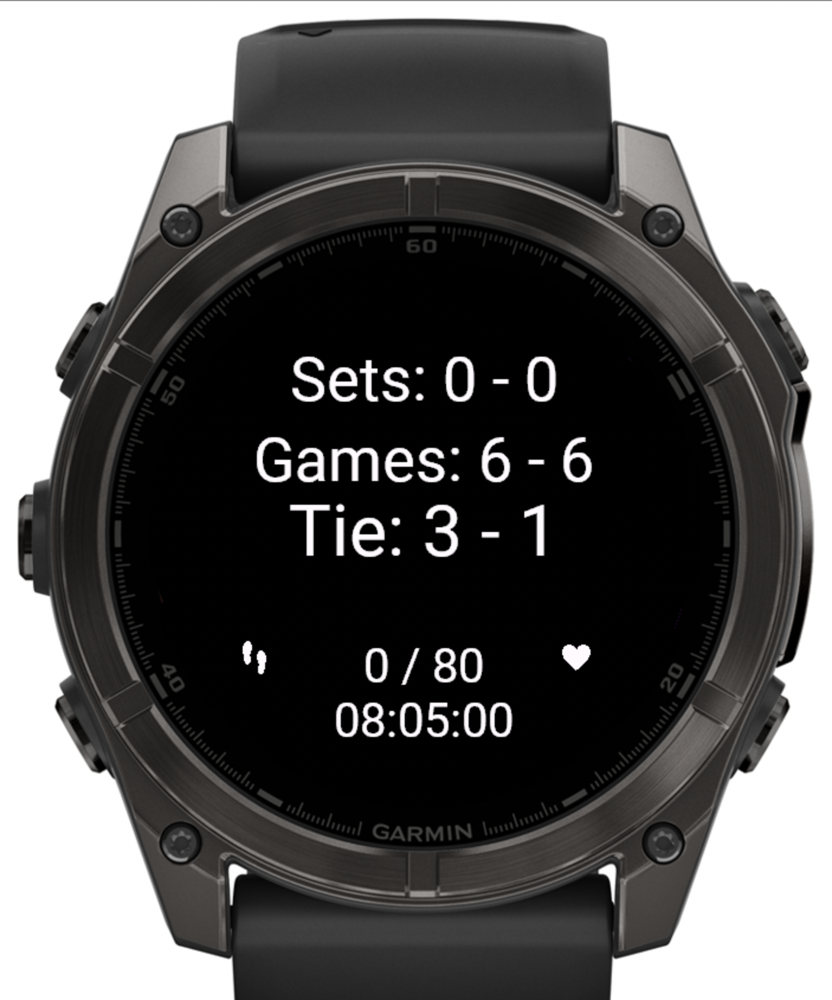

#### Who is serving

If you picked who serves first, a white marker on the screen edge shows the serving team: on the **top** half when your team serves, on the **bottom** half when the opponents serve (the same halves as the `Up` / `Down` buttons and the tap areas). Round screens show an arc; rectangular screens and Instinct show a bar. Say the server's score first when calling it out loud.

The marker moves on its own after every game, and inside tie-breaks after the first point and then every two points. If it is on the wrong team (for example, you picked the wrong one at the start), open **Options** → **Switch server**. That can be undone like a point.

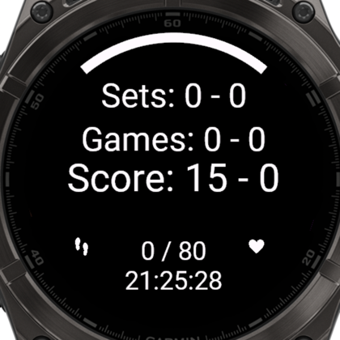
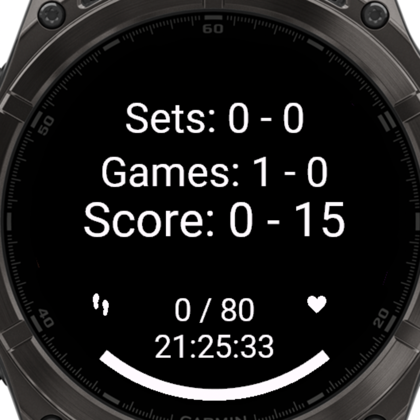

### Options, undo, and finishing

Press **`Enter`** / **`Start`** on the score screen, or **long-press** on a touch device, to open **Options**:

* **Undo last point** — asks for confirmation before reverting.
* **Unforced error** — increments the error counter (also saved with the activity and available in garmin connect later).
* **Switch server** — flips the serving team shown by the serving indicator from now on (the sub-label shows who is serving now). If you skipped **First serve**, this turns the indicator on with your team serving.
* **Switch to** (Friendly and Custom matches only) — play a **Tie-break**, **Super tie-break** or **Mini set** now. See [Switching to a tie-break, super tie or mini set](#switching-to-a-tie-break-super-tie-or-mini-set).
* **Finish activity** — **Save and exit**, **Discard**, or **Cancel** back to the score.

Pressing **`Back`** from the score screen opens the same **Finish activity** menu (save, discard, or cancel).

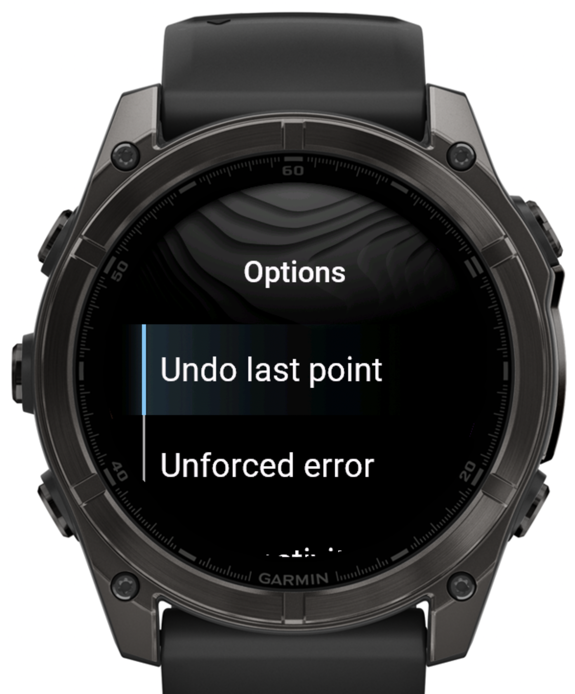

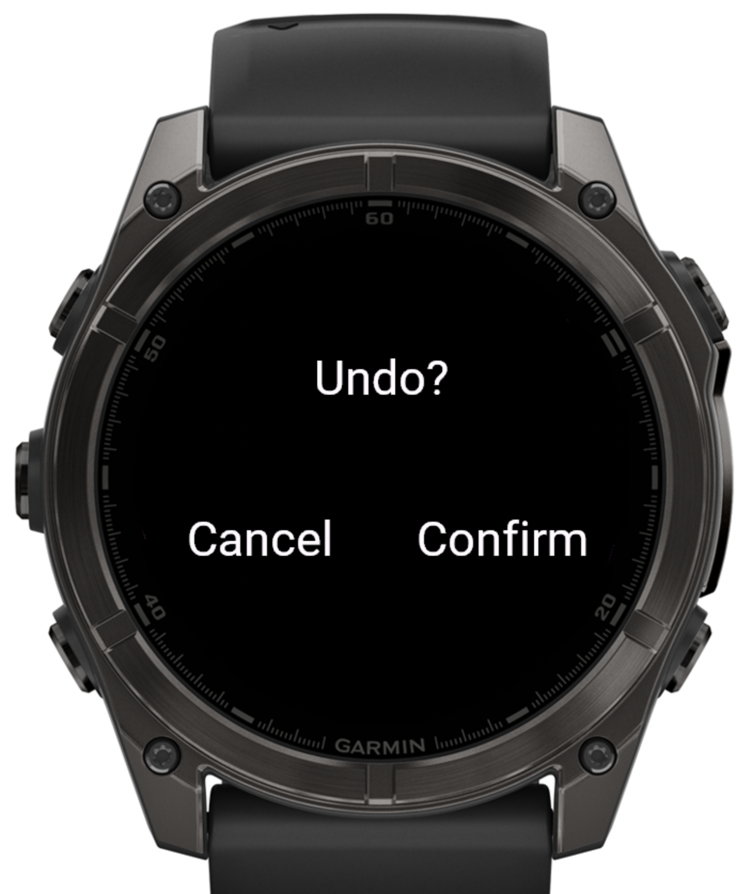

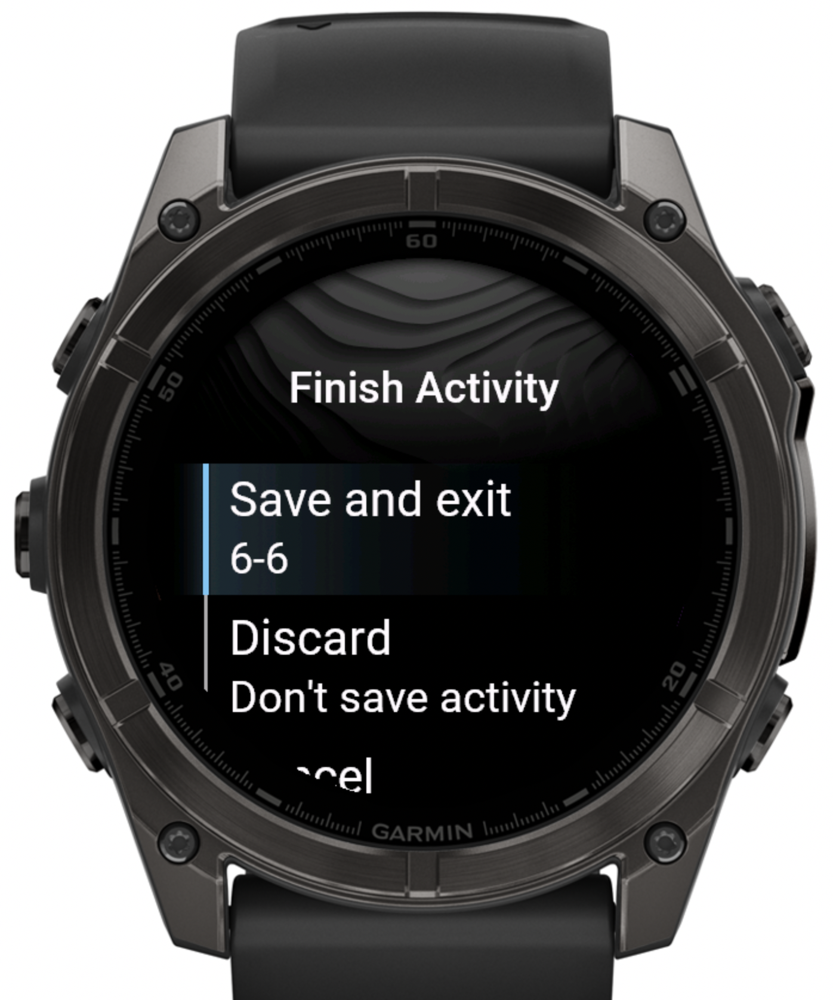

### Switching to a tie-break, super tie or mini set

In **Friendly** and **Custom** matches, **Options** → **Switch to** lets you play a shorter format right now, for example when your court time is running out:

* **Tie-break** — first to **7** points, win by 2.
* **Super tie-break** — first to **10** points, win by 2.
* **Mini set** — games start at **2–2**, first to **6** games.

You can switch at any moment:

* **Before any point of the set** (for example right after finishing a set): the new set is simply played in the chosen format.
* **In the middle of a set**: the current set is dropped. It isn't written to the score and nobody wins it; a game in progress is dropped too. The chosen format starts right away, as a new lap.

The sub-label of **Switch to** shows the set that switching would drop (for example `Drops 4-3`). The switch can be undone with **Undo last point**, which brings back the dropped set exactly; the lap that was added stays in the activity. After the chosen format finishes, the next set goes back to the match's usual set type. The serving indicator carries on as usual (a tie-break or super tie counts as one game).

The tournament presets keep their fixed rules, so they don't show this option.

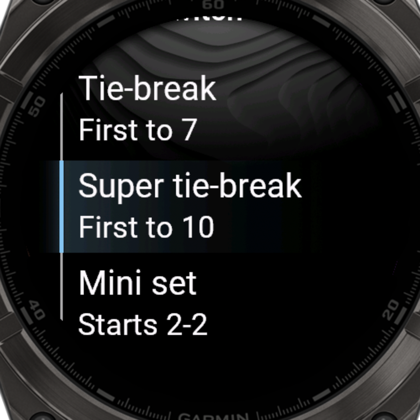
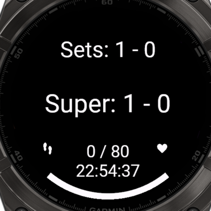

### Training

Pick **Training** in the Game Mode menu. The session starts in **free play**: nothing is scored, **Up** / **Down** do nothing, and the screen shows **Training**, **Free play** and how long this free-play period has lasted. Free play is also your warm-up.

When you want to play for points, open **Options** → **Start drill** and pick one:

* **Tie-break** — first to **7** points, win by 2.
* **Super tie-break** — first to **10** points, win by 2.
* **Mini set** — games start at **2–2**, first to **6** games.
* **Set** — a normal set (first to 6 games, tie-break at 6–6).

During a drill the score screen looks like a match, with **Drills: x - y** (drills won by us - them) at the top. The point rule is **Golden point**. When a drill is won, the watch vibrates, shows the result for a moment and goes back to free play by itself.

**Options** shows only what makes sense at that moment:

* **In free play**: **Start drill**, **Undo** (only when there is something to undo, for example right after ending or winning a drill), **Unforced error**, **Finish activity**.
* **During a drill**: **End drill** (back to free play), **Next drill** (go straight to another drill), **Undo last point**, **Unforced error**, **Switch server**, **Finish activity**.

A drill that you end early (with **End drill**, **Next drill** or **Finish activity**) is **saved with its score so far**, for example `TB [4-3]`, but counts for nobody in **Drills: x - y**. The sub-label of **End drill** shows what will be saved (for example `Saves [4-3]`). A drill ended before any point is played isn't written to the score. **Undo** right after **End drill** or **Next drill** brings the drill back exactly. Undo never goes back into a free-play period once a drill has started from it (that free-play period is already saved as a lap).

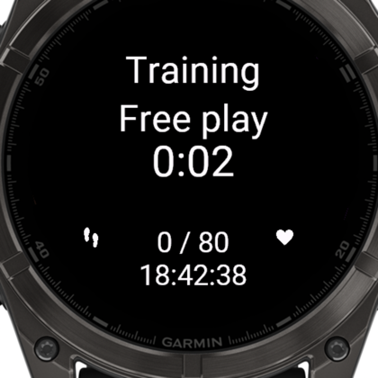
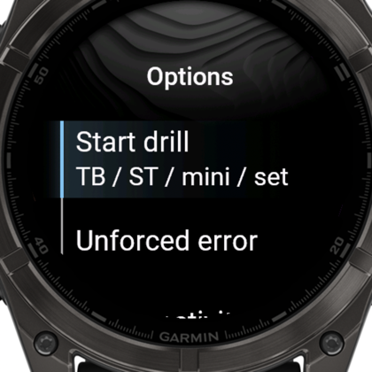

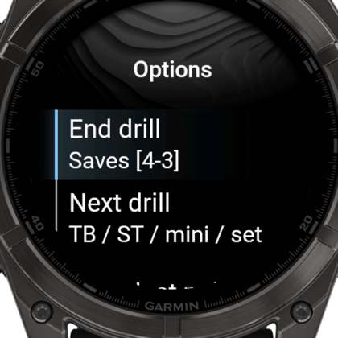
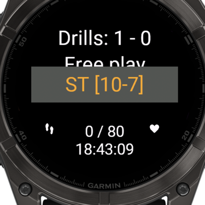

The serving indicator is **off** in training, because players usually decide who serves for each drill. During a drill, **Options** → **Switch server** turns it on with your team serving. Each new drill starts with it off again.

**What is saved:** every free-play period and every drill is its own **lap**, and each lap has a **Lap Score**: the drill's result (`TB [7-5]`, `ST [10-8]`, `MS 6-4`, `6-3` for a set), `Free` for free play, and the score so far of a drill ended early (for example `TB [4-3]`). Training activities have **no activity score**: the score field holds only 49 characters, too few for a whole training, so the laps are the record. On the watch, **Finish activity** shows a summary such as `Drills 2-1: TB [7-5] / ST [8-10] / MS 6-4` (drills won by us - them, then each drill). A lap can't be changed once it is saved: if you undo the winning point of a drill (or undo **End drill** / **Next drill**), the lap already saved for it stays, and the drill gets a second lap when it ends again.

### After the last point (limited matches)

If the match ends because a player/team has won the required sets, a **summary** screen is shown. Press **`Enter`** or tap to open **Finish activity** and save or discard as above.

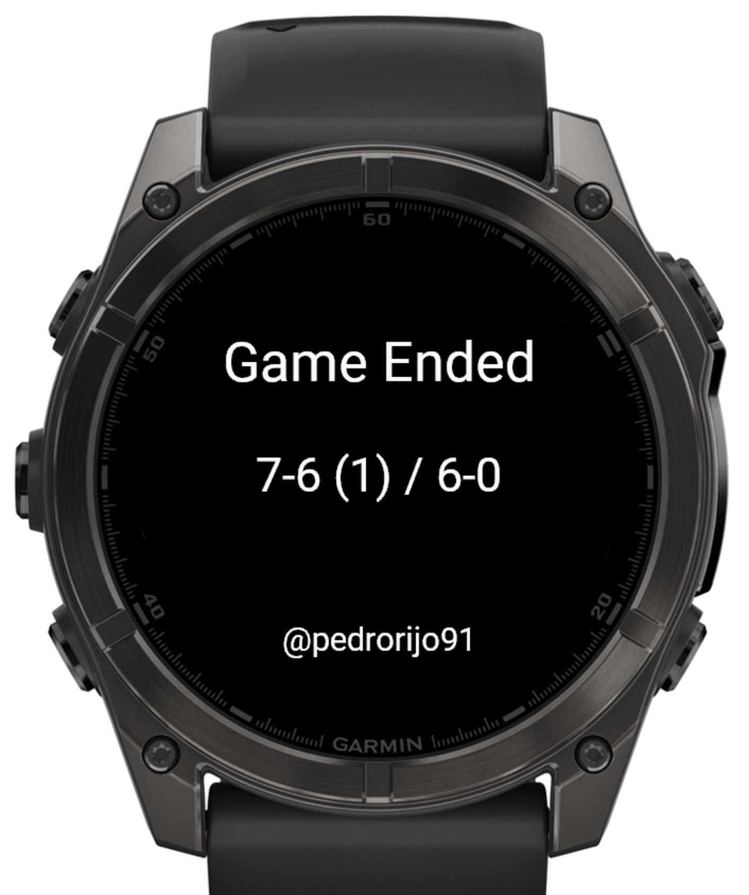

### Garmin Connect

After syncing, open the saved **padel** activity in Garmin Connect to see the recorded **score**, **steps** during the session, **unforced errors**, **warm-up** length (in seconds) and **app version** in the activity details (exact layout depends on Connect / device).

The activity's **laps** follow the match: with a warm-up, **lap 1 is the warm-up**, then one lap per set. Laps can't be named from a watch app, so Connect shows them as Lap 1, Lap 2, ... In **Training**, each lap has a **Lap Score** (the drill's result, or `Free`), so you can tell the laps apart.

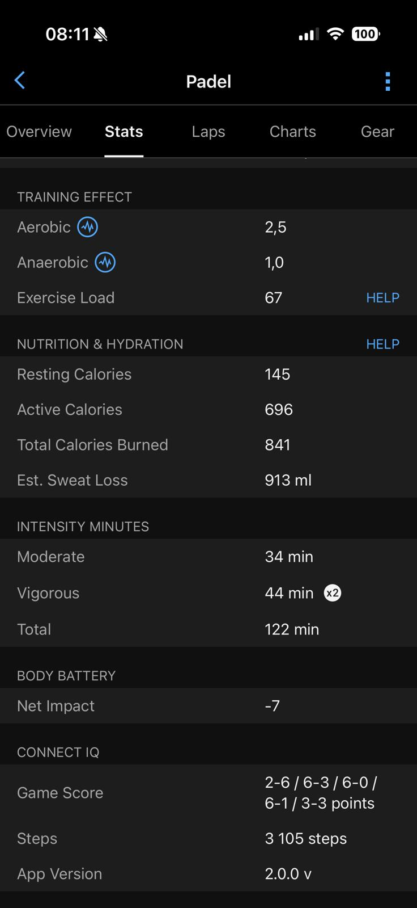

## Match rules reference

This section describes **what the app implements**, not the on-watch menus (those are covered in [How to use](#how-to-use)).

### Match format (sets)

* **1, 3, or 5 sets**: the match ends when one side has won enough sets (e.g. 2 of 3, 3 of 5).
* **Unlimited**: the session does not auto-finish on set count; you end it from **Options** or **Back** when you want to save or discard the activity.

**Super tie-break** can be turned on only when you chose **3** or **5** sets. If sets would end in a draw at the last possible moment (e.g. **1–1** in a best-of-3 match with super tie enabled), the **deciding set is not played as games**: it is a single **super tie-break** (see below).

### Set types (games within a set)

All set types use **standard padel-style game scoring** (0 → 15 → 30 → 40, then game / deuce, depending on the **point rule** you picked). **Tie-breaks** inside a set are **first to 7 points, win by 2**.

| Set type | Win the set | Tie-break when |
|----------|-------------|----------------|
| **Normal** | First to **6** games, **win by 2** | **6–6** |
| **Pro set** | First to **9** games, **win by 2** | **8–8** |
| **Mini** | Games start at **2–2**; first to **6** games, **win by 2** | **5–5** |

### Super tie-break (deciding set)

When the match configuration uses a super tie for the decider, that **entire final “set”** is a **super tie-break**: **first to 10 points, win by 2**. There are no games inside that set.

### Tie-break, super tie-break or mini set chosen mid-match

With **Switch to** (Friendly and Custom), a set can be played as a single **tie-break** (first to **7** points, win by 2), a single **super tie-break** (first to **10**, win by 2) or a **mini set** (see the set types table). It counts as one set for whoever wins it; in a 3- or 5-set match it counts towards the sets needed to win. A set dropped by switching counts for nobody and isn't written to the score.

### Training drills

In **Training**, drills use the same rules: **tie-break** (first to 7, win by 2), **super tie-break** (first to 10, win by 2), **mini set** and **set** (see the set types table), with golden point. A won drill counts as one drill for the winner (**Drills: x - y**). Results say which drill it was: `TB` = tie-break, `ST` = super tie-break, `MS` = mini set, no prefix = set. Tie-break results are written in brackets, for example `TB [7-5]`. A drill ended early is written with its score so far (`TB [4-3]`, `MS 4-3`) but counts for nobody; such a score can't be a finished drill, so it needs no marker.

### Point rules at deuce (40–40)

These options only change what happens when a game reaches **40–40** (deuce):

* **Golden point** — the **next** point wins the game.
* **Advantages** — classic **advantage / deuce**: after deuce, a side needs **advantage** and then **another** point to win the game; losing advantage returns to deuce.
* **Silver point** — like advantages, but each time play returns to deuce **after** the receiving side had **advantage**, a counter advances. After **one** such return to deuce, the **next** time the score is 40–40, the **following point** wins the game (no further advantage play in that game).
* **Star point** (FIP-style) — same hybrid idea as Silver, but **two** returns to deuce from that advantage situation are allowed before the next 40–40 point becomes **decisive** (wins the game).

### Tie-break scoring (within a set)

During a normal set **tie-break** (not the super tie), the UI shows **Tie:** *points–points*. Points are counted numerically; win the tie-break by reaching **7** points with a **margin of 2**.

## List of supported devices

See `<iq:products>` element in [manifest.xml](https://github.com/pedrorijo91/garmin-padel/blob/main/manifest.xml#L16) file.

While there's nothing preventing other devides to be supported, due to limited access to test on other devices, support is only focused on the following ranges at this moment:

* garmin forerunner (165, 245, 265, 645, 735, 745, 935, 945, 965)
* garmin fenix 5, 6, 7, 8 (s/X/pro)
* garmin epix 2
* garmin descent mk2i/mk2s, mk3

Feel free to raise an issue asking support for any specific device.

Note: api level by device listed in [garmin dev docs](https://developer.garmin.com/connect-iq/compatible-devices/)

## Garmin Connect app link

available in [garmin connect app store](https://apps.garmin.com/apps/c63edba4-4217-4345-9ebc-86a90307e968?tid=0)

## Maintainer / development

Release workflow and developer resource links: [RELEASING.md](RELEASING.md).
